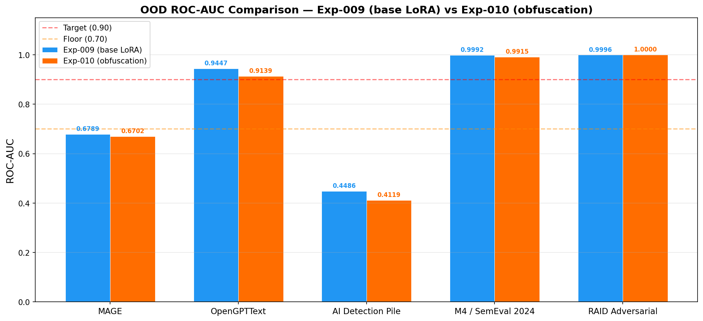
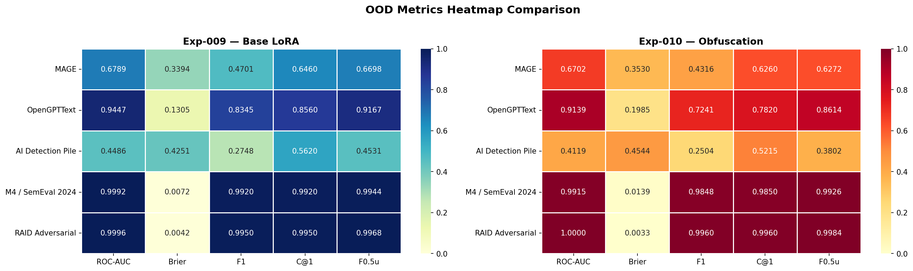
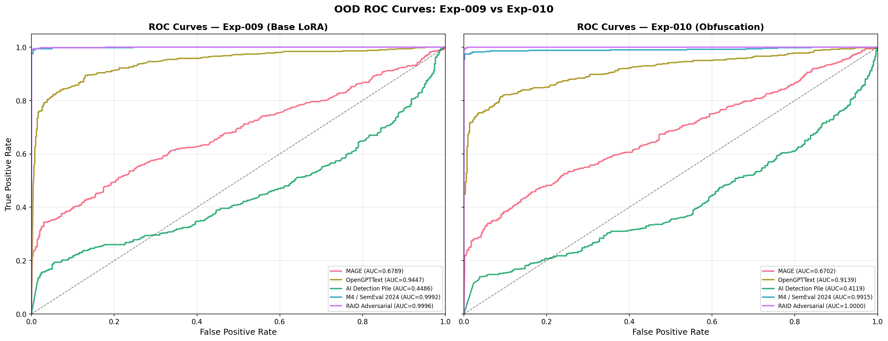
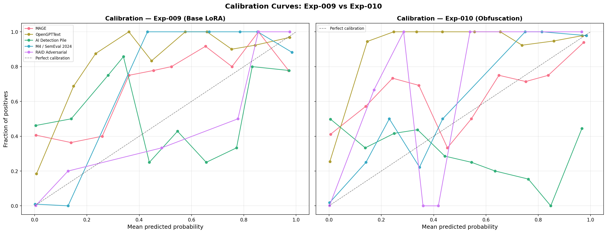

# Results: 011-extensive-ood-evals

**Date Completed**: 2026-03-02
**Author**: tanish

## Summary

Evaluated **two models** on **5 out of 7 planned OOD datasets**. TuringBench and HC3 Multi-Domain failed to load at runtime (dataset availability / format issues on HuggingFace) and were excluded from both runs.

| Model | Adapter | Avg ROC-AUC |
|-------|---------|-------------|
| **Exp-009** | `hersheys-baklava/qwen-lora-pan2026-009` (base LoRA) | 0.8142 |
| **Exp-010** | `hersheys-baklava/qwen-lora-pan2026-010-obfuscation` (obfuscation-augmented) | 0.7975 |

Both models show **extreme polarization** in OOD generalization. Near-perfect performance on M4/SemEval 2024 and RAID Adversarial contrasts with catastrophic failure on AI Detection Pile (Exp-009: 0.4486, Exp-010: 0.4119 — both worse than random) and poor performance on MAGE (~0.68). The obfuscation augmentation did **not** improve OOD generalization and slightly degraded average performance. **Both evaluations fail all three success criteria.**

## Results Tables

### Exp-009 — Base LoRA (`qwen-lora-pan2026-009`)

| Dataset | ROC-AUC | Brier | F1 | C@1 | F0.5u |
|---------|---------|-------|-----|------|-------|
| MAGE | 0.6789 | 0.3394 | 0.4701 | 0.6460 | 0.6698 |
| OpenGPTText | 0.9447 | 0.1305 | 0.8345 | 0.8560 | 0.9167 |
| AI Detection Pile | 0.4486 | 0.4251 | 0.2748 | 0.5620 | 0.4531 |
| M4 / SemEval 2024 | 0.9992 | 0.0072 | 0.9920 | 0.9920 | 0.9944 |
| RAID Adversarial | 0.9996 | 0.0042 | 0.9950 | 0.9950 | 0.9968 |
| ~~TuringBench~~ | — | — | — | — | — |
| ~~HC3 Multi-Domain~~ | — | — | — | — | — |
| **AVERAGE (5 datasets)** | **0.8142** | **0.1813** | **0.7133** | **0.8102** | **0.8061** |

### Exp-010 — Obfuscation-Augmented (`qwen-lora-pan2026-010-obfuscation`)

| Dataset | ROC-AUC | Brier | F1 | C@1 | F0.5u |
|---------|---------|-------|-----|------|-------|
| MAGE | 0.6702 | 0.3530 | 0.4316 | 0.6260 | 0.6272 |
| OpenGPTText | 0.9139 | 0.1985 | 0.7241 | 0.7820 | 0.8614 |
| AI Detection Pile | 0.4119 | 0.4544 | 0.2504 | 0.5215 | 0.3802 |
| M4 / SemEval 2024 | 0.9915 | 0.0139 | 0.9848 | 0.9850 | 0.9926 |
| RAID Adversarial | 1.0000 | 0.0033 | 0.9960 | 0.9960 | 0.9984 |
| ~~TuringBench~~ | — | — | — | — | — |
| ~~HC3 Multi-Domain~~ | — | — | — | — | — |
| **AVERAGE (5 datasets)** | **0.7975** | **0.2046** | **0.6774** | **0.7821** | **0.7720** |

### Head-to-Head ROC-AUC

| Dataset | Exp-009 | Exp-010 | Δ (009−010) |
|---------|---------|---------|-------------|
| MAGE | 0.6789 | 0.6702 | +0.0087 |
| OpenGPTText | 0.9447 | 0.9139 | +0.0308 |
| AI Detection Pile | 0.4486 | 0.4119 | +0.0367 |
| M4 / SemEval 2024 | 0.9992 | 0.9915 | +0.0077 |
| RAID Adversarial | 0.9996 | 1.0000 | −0.0004 |
| **AVERAGE** | **0.8142** | **0.7975** | **+0.0167** |

Exp-009 outperforms Exp-010 on 4 of 5 datasets. The obfuscation augmentation yielded no OOD benefit.

## Baselines (In-Distribution)

### Exp-009

| Dataset | ROC-AUC |
|---------|---------|
| PAN2025 Val | 0.9993 |
| HC3 Wiki | 0.9977 |
| RAID | 0.9974 |

### Exp-010

| Dataset | ROC-AUC |
|---------|---------|
| PAN2025 Val | 0.9995 |
| HC3 Wiki | 0.9985 |
| RAID | 0.9964 |

## Per-Dataset Analysis

### Tier 1: Near-Perfect (ROC-AUC ≥ 0.99)

- **RAID Adversarial** (Exp-009: 0.9996, Exp-010: 1.0000): Both models handle adversarial perturbations flawlessly. Since RAID was part of both training evaluation suites, the adversarial subset provides a sanity check — both pass easily.

- **M4 / SemEval 2024** (Exp-009: 0.9992, Exp-010: 0.9915): Near-perfect discrimination on this multi-domain benchmark. All metrics above 0.98 for both models. Strong generalization to competition-style AI text.

### Tier 2: Good (ROC-AUC ≥ 0.90)

- **OpenGPTText** (Exp-009: 0.9447, Exp-010: 0.9139): Solid performance on GPT-generated Wikipedia introductions for both models. Exp-009 scores notably higher (+0.031). Both show moderate calibration issues (Brier ~0.13–0.20).

### Tier 3: Poor (ROC-AUC < 0.70)

- **MAGE** (Exp-009: 0.6789, Exp-010: 0.6702): Both models fail to generalize to this 27-LLM multi-domain benchmark. The gap between models is small; neither learns general AI-detection features.

- **AI Detection Pile** (Exp-009: 0.4486, Exp-010: 0.4119): **Worse than random chance for both models.** Predictions are actively inverted — both models tend to classify AI text as human and vice versa. Long-form essays from GPT-2/3/ChatGPT/GPT-J expose anti-correlated heuristics in both models. Exp-009 is marginally less wrong (+0.037).

## Visualizations

### ROC-AUC Comparison

Grouped bar chart comparing both models across all 5 OOD datasets. Exp-009 (blue) consistently outperforms Exp-010 (orange) except on RAID Adversarial where Exp-010 achieves a perfect 1.0000. Both models show the same three-tier structure.

### Metrics Heatmap

Side-by-side heatmaps for Exp-009 (YlGnBu) and Exp-010 (YlOrRd). The performance gap is consistent across all metrics — MAGE and AI Detection Pile are uniformly poor for both models; M4 and RAID are uniformly strong.

### ROC Curves

Side-by-side ROC curve overlays for each model. In both panels, the AI Detection Pile curve falls *below* the diagonal (anti-correlated predictions), and MAGE tracks loosely above it. M4 and RAID curves are near-perfect for both models.

### Calibration Curves

Side-by-side calibration diagrams for each model. Calibration varies dramatically by dataset and is similar across both models. The AI Detection Pile calibration curve trends downward at high predicted probabilities — the model is most confident precisely when it is most wrong.

## Success Criteria

### Exp-009

| Criterion | Target | Actual | Status |
|-----------|--------|--------|--------|
| Avg OOD ROC-AUC | ≥ 0.90 | 0.8142 | ❌ Fail |
| Floor ROC-AUC (no dataset below) | ≥ 0.70 | 0.4486 (AI Detection Pile) | ❌ Fail |
| Avg Brier Score | ≤ 0.10 | 0.1813 | ❌ Fail |

### Exp-010

| Criterion | Target | Actual | Status |
|-----------|--------|--------|--------|
| Avg OOD ROC-AUC | ≥ 0.90 | 0.7975 | ❌ Fail |
| Floor ROC-AUC (no dataset below) | ≥ 0.70 | 0.4119 (AI Detection Pile) | ❌ Fail |
| Avg Brier Score | ≤ 0.10 | 0.2046 | ❌ Fail |

## Key Takeaways

1. **Obfuscation augmentation does not improve OOD generalization.** Exp-010 is marginally worse than Exp-009 on 4 of 5 OOD datasets. The augmentation did not teach generalizable AI-detection features.

2. **Neither model is broadly generalizable.** Despite near-perfect in-distribution performance (>0.999), both catastrophically fail on AI Detection Pile. Domain and generator matter far more than training augmentation.

3. **Anti-correlated predictions are a shared failure mode.** Both models score below 0.50 on AI Detection Pile — they have learned heuristics counter-productive for long-form GPT-2/3 essays, likely length or formatting artifacts.

4. **Exp-009 is the stronger OOD model** (+0.017 avg ROC-AUC). Obfuscation augmentation yielded no measurable benefit for generalization.

5. **Two datasets (TuringBench, HC3 Multi-Domain) failed to load** in both runs and should be investigated in a follow-up.

6. **For CLEF submission, these weaknesses may not be fatal** if PAN2026's test distribution resembles PAN2025's. However, the results highlight risks if the competition introduces novel generators or text styles.

## Artifacts

| File | Description | Location |
|------|-------------|----------|
| `all_ood_results.json` (010) | Combined metrics — Exp-010 model | [`pan2026-011-ood-eval-results`](https://huggingface.co/datasets/hersheys-baklava/pan2026-011-ood-eval-results) |
| `all_ood_results.json` (009) | Combined metrics — Exp-009 model | [`pan2026-011-ood-eval-results-009`](https://huggingface.co/datasets/hersheys-baklava/pan2026-011-ood-eval-results-009) |
| `ood_roc_comparison.png` | Grouped ROC-AUC bar chart (both models) | local `artifacts/` |
| `ood_metrics_heatmap.png` | Side-by-side metrics heatmap (both models) | local `artifacts/` |
| `ood_roc_curves.png` | Side-by-side ROC curve overlays (both models) | local `artifacts/` |
| `ood_calibration_curves.png` | Side-by-side calibration curves (both models) | local `artifacts/` |
| `*_results.json` | Per-dataset metrics | both HF repos |
| `*_predictions.json` | Per-dataset probabilities and labels | both HF repos |
